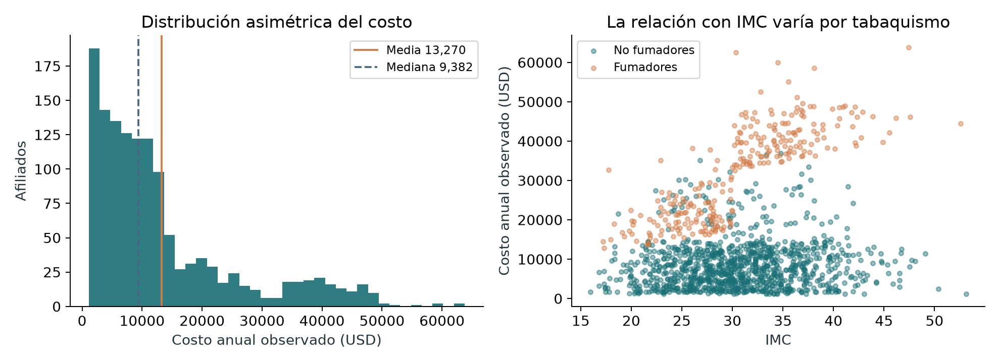
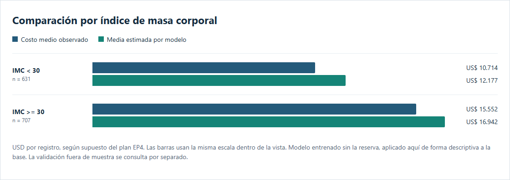

EP5 / 01

Implementación y control del proyecto

Análisis de factores asociados a los costos de atención médica en una aseguradora de salud privada

| Estudiante y asignatura | Evaluación y corte |
|---|---|

| Vicente Gabriel Zepeda Rojas SCY1102 Gestión de Proyectos de Datos | EP5, con evidencias de preparación EP6 11 de noviembre de 2026, America/Santiago |

| Docente: Jorge Alberto Moscoso Santander | Línea base: plan EP4 entregado el 14/10/2026 |

Resultado del encargo

Se implementó y ejecutó un pipeline en Python, un notebook con salidas, dos modelos de factores, reportes de costos por grupos y un dashboard interactivo. El seguimiento usa GitHub Issues y registros de estado, desviaciones y riesgos vinculados a los entregables E1-E5 del plan.

**El modelo M2 reduce el MAE de la reserva final en 49,4% frente al promedio base.** Su MAE de validación cruzada es US$ 5.039,52, superior a la referencia de US$ 4.824 del plan. El error presupuestario del grupo fumador en reserva es +15,21%. La implementación técnica queda disponible para revisión, con aceptación de negocio y recalibración pendientes.

Alcance y criterios de lectura

La base pública contiene 1.338 registros de referencia. Se analizan asociaciones y cambios de la media geométrica condicional, además de estimaciones aritméticas por grupo. Quedan fuera la cotización individual, el análisis causal, la integración con sistemas de una aseguradora y la ejecución del programa preventivo.

Las evidencias se generaron en esta sesión. No se reconstruyen reuniones, firmas, horas trabajadas ni semanas de seguimiento que no están documentadas. La firma del acta, la representatividad de la cartera y la aprobación del patrocinador continúan pendientes.

Acceso a la evidencia

[Repositorio del proyecto](https://github.com/vicezepeda/Medical-Cost-Personal_Proyect/) [Tablero de seguimiento en GitHub Issues](https://github.com/vicezepeda/Medical-Cost-Personal_Proyect/issues) [Notebook ejecutado](https://github.com/vicezepeda/Medical-Cost-Personal_Proyect/blob/main/notebooks/01_implementacion.ipynb) [Matriz de cumplimiento del plan y las pautas](https://github.com/vicezepeda/Medical-Cost-Personal_Proyect/blob/main/docs/matriz_cumplimiento.md)

Las pautas EP5 y EP6 contienen referencias internas a EP3 y porcentajes de plantilla inconsistentes. Para este encargo se aplican sus apartados específicos: informe de 5 a 8 páginas, implementación, monitoreo y control, presentación ejecutiva de 10 minutos y defensa.

EP5 / 02

Datos y ejecución reproducible

Validación de la fuente

| Control | Resultado | Decisión |
|---|---|---|

| Registros y variables | 1.338 filas, 7 variables | Conservar tamaño comprometido en E2 |

| Completitud | 0 valores nulos | No se requiere imputación |

| Duplicados exactos | 1 fila excedente | Conservar y mantener copias en el mismo split/fold |

| Dominio | Edad 18-64, IMC 15,96-53,13, hijos 0-5 | Categorías y costos positivos validados |

Fuente: archivo insurance.csv suministrado por el estudiante, vinculado a Medical Cost Personal Datasets de Miri Choi en Kaggle. USD y horizonte anual siguen el supuesto del plan EP4; el CSV no incorpora fecha ni unidad temporal. El hash permite verificar la entrada. No se añaden identificadores ni datos clínicos de una cartera real.

SHA-256: 388eff679557d08ac19f463d025de5e0b4adc482537c8456d19934d78621fd47

La media observada es US$ 13.270, frente a una mediana de US$ 9.382. El 20,5% de registros corresponde a fumadores y concentra el 49,5% del gasto. Los 134 registros de mayor costo concentran el 31,98%. La diferencia con el 31,8% preliminar del plan depende del redondeo y del corte exacto de 10% (se usa techo de 133,8).

Implementación verificable

El flujo carga y valida la fuente, prepara log(charges) e IMC centrado en 30, asigna particiones, ajusta modelos, compara métricas y exporta diagnósticos y agregados. El notebook documenta la ejecución. El diccionario define variables, unidades, categorías y columnas derivadas.

Comandos desde la raíz: **python -m src.analysis**; **python -m pytest -q**; **python dashboard/app.py**. Las versiones exactas quedan fijadas en requirements.txt. El registro results/logs/execution.json identifica fecha, hash de entrada y productos generados.

EP5 / 03

Comparación de modelos y validación

M1: log(charges) = edad + sexo + IMC centrado + hijos + tabaquismo + región. M2: M1 + interacción IMC centrado × tabaquismo. Ambos usan OLS con errores estándar robustos HC3. El IMC se centra en 30 para interpretar el contraste de tabaquismo en ese valor.

Diseño de evaluación

Se separaron 1069 registros para entrenamiento y 269 para reserva final mediante GroupShuffleSplit con semilla 42. Dentro del entrenamiento se aplicó validación cruzada de 5 particiones, estratificada por tabaquismo y agrupada por filas idénticas. No hay copias exactas compartidas entre entrenamiento, validación o reserva.

En cada fold se ajustan el modelo y el factor de smearing por tabaquismo utilizando únicamente los datos de entrenamiento. Este factor convierte exp(predicción log) a una aproximación de la media en USD. La selección usa el menor MAE USD de las predicciones fuera de fold. El AIC es evidencia complementaria para modelos con igual respuesta logarítmica.

| Modelo | AIC en train log | MAE CV USD | RMSE CV USD | R² CV USD |
|---|---|---|---|---|

| Promedio base | No aplica | 9.208,71 | 12.265,60 | -0,001 |

| M1 aditivo | 1.321,61 | 5.099,15 | 9.252,18 | 0,430 |

| M2 interacción | 1.257,88 | 5.039,52 | 9.757,56 | 0,366 |

M2 reduce el AIC en 63,73 y el MAE CV en 1,17% respecto de M1. Sin embargo, empeora RMSE y R² en USD. Se conserva como modelo explicativo por la regla de MAE fijada antes de evaluar la reserva; su mejora es modesta y no justifica afirmar superioridad en todas las métricas.

Reserva final y referencia del plan

| Métrica | M2 en reserva | Promedio base |
|---|---|---|

| MAE USD | 4.505,95 | 8.904,19 |

| RMSE USD | 8.414,67 | 11.486,62 |

| R² en USD | 0,462 | -0,003 |

La referencia EP4 de MAE CV ≤ US$4.824 no se cumple: M2 la excede en US$215,52 (+4,47%). El R² log de reserva es 0,806 y el R² USD es 0,462: corresponden a escalas distintas y no deben intercambiarse. La reserva no se reutiliza para recalibrar en esta entrega.

EP5 / 04

Asociaciones y costos por grupos

Los cambios porcentuales se calculan como 100 × (exp(β) - 1), con el resto de variables constante. Describen la media geométrica condicional en el modelo logarítmico. No equivalen automáticamente a un cambio en la media aritmética ni a un efecto causal. La tabla utiliza el ajuste de entrenamiento y contrastes HC3.

| Comparación | Cambio % | IC95% del cambio | p HC3 |
|---|---|---|---|

| Edad: +1 año | 3,47 | 3,24 a 3,70 | <0,001 |

| Hijos: +1 | 10,24 | 8,15 a 12,37 | <0,001 |

| IMC: +1 en no fumadores | 0,47 | -0,03 a 0,96 | 0,064 |

| IMC: +1 en fumadores | 4,81 | 3,96 a 5,66 | <0,001 |

| Fumador vs. no fumador con IMC 30 | 351,26 | 322,83 a 381,61 | <0,001 |

La asociación del IMC cambia con tabaquismo. En no fumadores, el intervalo de +1 unidad de IMC incluye cero; en fumadores, el cambio es +4,81% por unidad. El contraste fumador/no fumador depende del IMC, por lo que no se presenta un único porcentaje general. El archivo effects.csv incluye sexo, región y contrastes para distintos IMC.

Descripción de los cuatro grupos IMC y tabaquismo

| Grupo observado | n | Media USD | IC95% aproximado |
|---|---|---|---|

| No fumador, IMC < 30 | 502 | US$ 7.977 | US$ 7.466 a US$ 8.488 |

| No fumador, IMC >= 30 | 562 | US$ 8.843 | US$ 8.338 a US$ 9.347 |

| Fumador, IMC < 30 | 129 | US$ 21.363 | US$ 20.489 a US$ 22.238 |

| Fumador, IMC >= 30 | 145 | US$ 41.558 | US$ 40.576 a US$ 42.540 |

Estos intervalos describen la media muestral con aproximación normal; no son intervalos de predicción para personas. El mayor costo observado entre fumadores con IMC ≥30 motiva una pregunta preventiva, pero la base carece de diagnósticos, historial clínico y asignación aleatoria para atribuir causalidad.

Control del presupuesto grupal en reserva

| Grupo | n reserva | Media real | Media estimada | Error del total |
|---|---|---|---|---|

| No fumador | 212 | US$ 8.126 | US$ 8.421 | +3,64% |

| Fumador | 57 | US$ 29.951 | US$ 34.508 | +15,21% |

El +15,21% del grupo fumador requiere recalibración y validación con otra muestra antes de presupuestar. El ±10% del plan corresponde al gasto del proyecto, no a una tolerancia aprobada para el modelo. Se propone revisar el error grupal con finanzas; no se declara una nueva meta como aprobada.

EP5 / 05

Diagnósticos y entregable funcional

Supuestos revisados y límites

Breusch-Pagan/Koenker: p = 1.08e-10. Jarque-Bera: p menor que la precisión numérica mostrada. Los residuos presentan heterocedasticidad y falta de normalidad. Se detectaron 73 observaciones por encima de 4/n en distancia de Cook; se mantienen y se informa su influencia. No se eliminan altos costos sólo por ser extremos.

HC3 hace más robustos los errores estándar frente a heterocedasticidad, pero no corrige la forma funcional, la selección de la muestra ni la independencia no verificable sin identificadores. El archivo de diagnósticos y los gráficos de residuos y Q-Q acompañan la evaluación. El proyecto no acredita cumplimiento estadístico pleno de todos los supuestos.

Dashboard de costos por grupos

El filtro de tabaquismo opera sobre comparaciones por IMC, edad, región e hijos. Cada vista informa n, costo observado y media estimada con el modelo de entrenamiento aplicado a la base de referencia. Esa vista descriptiva no constituye una validación independiente. Se omiten celdas con n&lt;5 y se advierte n&lt;20.

| Prueba funcional | Evidencia y resultado |
|---|---|

| Filtros y agregación | 12 combinaciones verificadas; n y media ponderada coinciden con JSON |

| Rendimiento local | 5 navegaciones; máximo 622,2 ms, menor a 3 s |

| Vista móvil | 390 × 844 px emulados, sin desborde horizontal del documento |

| Errores JavaScript | 0 en las combinaciones probadas |

Las capturas y dashboard_validation.json documentan un entorno local Chromium headless. No prueban un teléfono físico, una red externa ni rendimiento de producción. La tabla puede desplazarse horizontalmente dentro de su contenedor en pantalla pequeña.

EP5 / 06

Ejecución, monitoreo y trazabilidad

GitHub sustituye el tablero Trello y centraliza código, issues, entregables y acciones. Python local y notebook reproducible sustituyen la herramienta prevista Colab. El PPTX editable sustituye Canva. Son cambios de herramienta para conservar evidencia en un único repositorio, sin alterar los objetivos. La equivalencia queda registrada como decisión de implementación, pendiente de ratificación si el docente exige una herramienta específica.

| Línea base EP4 | Ejecución verificable al corte | Estado |
|---|---|---|

| E1 S2: acta firmada y priorización | MoSCoW disponible. No hay firma ni evidencia de representatividad. Issue #1. | Pendiente externo |

| E2 S4: base de 1.338 filas y diccionario | Esquema y calidad validados, hash y diccionario. Duplicado auditado. Issue #2. | Técnico completo |

| E3 S7: comparar modelos y revisar supuestos | M1/M2, CV5, AIC, p-valores, residuos y grupos. Referencia MAE incumplida. Issue #3. | Evaluación completa; aceptación pendiente |

| E4 S9: filtros, <3 s, móvil | Dashboard funcional con 12 combinaciones y prueba local. Issue #4. | Técnico completo en local |

| E5 S12: informe/PPT/piloto aprobados | Informe, PPT, guion de 10 min y propuesta. Defensa y aprobación sin evidencia. Issue #5. | Documentos listos; compuerta pendiente |

Reportes de estado y control de cambios

R0 registra revisión de insumos, alcance y apertura de tareas. R1 documenta ejecución técnica y pruebas. R2 registra el cierre documental y las restricciones remanentes. Son cortes de esta sesión, no reportes semanales retrospectivos. Cada tarea vincula requisito, evidencia, responsable, resultado y próxima acción.

Los archivos plan_vs_ejecucion.csv, desviaciones.csv y riesgos.csv permiten revisar el detalle. La bitácora registra decisiones y sus motivos. GitHub Issues #1-#5 conserva el estado real y las listas de aceptación; una tarea técnica cerrada no acredita aprobación del patrocinador.

Control del calendario y recursos

El plan usa doce semanas relativas y un integrante en seis roles. No existe una fecha de inicio confirmada, por lo que no se convierte S2/S4/S7/S9/S12 en fechas reales ni se afirma cumplimiento a tiempo. Las 200 h y US$2.519 son línea base estimada. Sin partes de horas ni costos reales, las desviaciones de tiempo y gasto, CPI y SPI son no calculables.

[Consultar estado vigente de los issues](https://github.com/vicezepeda/Medical-Cost-Personal_Proyect/issues) · [Consultar tablero y próximos pasos](https://github.com/vicezepeda/Medical-Cost-Personal_Proyect/blob/main/gestion/tablero.md)

EP5 / 07

Desviaciones, acciones y riesgos

| Hallazgo o desviación | Decisión y acción correctiva | Verificación / condición pendiente |
|---|---|---|

| Duplicado frente a riesgo de fuga | Conservar 1.338 filas por E2. Agrupar copias en todas las particiones. | Cero cruce de grupos; pruebas automáticas. |

| MAE CV +4,47% sobre referencia | Informar incumplimiento. Mantener M2 como análisis explicativo. Evaluar otro protocolo en ciclo posterior. | Sin reutilizar reserva para ajustar. Aceptación de negocio pendiente. |

| M2 empeora RMSE y R² USD | Explicar que la regla de MAE no optimiza todos los errores. | Comparación completa M1/M2; sin selección oportunista por holdout. |

| Sesgo fumadores +15,21% en reserva | No trasladar cifras directamente a una cartera. Recalibrar con muestra independiente y validar por grupo. | Riesgo abierto hasta nueva evaluación. |

| Heterocedasticidad/no normalidad | HC3, smearing y diagnósticos. No borrar extremos sin justificación. | Inferencia y medias retransformadas con límites explícitos. |

| Ausencia de calendario y costos reales | Conservar semanas y presupuesto como estimaciones. | Horas/gasto/SPI/CPI ND hasta contar con registros. |

| Sin acta ni aprobaciones acreditadas | Mantener compuertas abiertas. Entregar documentación para revisión. | Firma, representatividad y defensa requieren evidencia externa. |

Riesgos al corte

**Representatividad:** la fuente pública no describe cómo se seleccionó una cartera real. Acción: acordar un protocolo de comparación de perfiles antes de uso operativo. **Interpretación causal:** las diferencias de costos pueden contener confusión no medida. Acción: lenguaje asociativo y piloto con grupo comparador. **Privacidad:** se usa sólo la fuente pública y el dashboard publica agregados. No se incorporan datos reales de salud; cualquier futura carga requiere revisión de acceso y tratamiento. **Calibración:** el error grupal del modelo puede sesgar presupuestos. Acción: mantener pendiente su aceptación operativa.

Responsable de las acciones: Vicente Gabriel Zepeda Rojas en los roles del plan; las decisiones de aceptación corresponden al patrocinador y las decisiones académicas al docente. La matriz completa incluye probabilidad, impacto, mitigación y evidencia de seguimiento.

EP5 / 08

Propuesta de piloto y entrega EP6

Piloto preventivo como hipótesis de evaluación

Se mantiene la propuesta EP4 de 250 participantes, seis meses y US$97.100 de presupuesto supuesto, equivalente a US$388,40 por participante. El programa no se ejecutó. La cesación de 25% y cualquier reducción de costo son hipótesis; las asociaciones del modelo no prueban esos resultados.

Con costo anual de referencia de fumadores US$32.050,23, recuperar US$388,40 requiere 1,21% de reducción promedio entre todos los participantes. Si sólo el 25% que deja de fumar obtiene una reducción, ese subgrupo necesitaría aproximadamente 4,85%. Usando el techo de US$390 del plan, son 1,22% y 4,87%. Esta distinción aclara la fórmula preliminar de 4,9% y evita atribuirla al promedio de todos.

El diseño propuesto compara intervención y control bajo protocolo acordado con responsables clínicos, mide participación, cesación y costos, e informa intervalos de incertidumbre y seguimiento. El horizonte anual de costos exige observación adicional a los seis meses de intervención. La ampliación depende de evidencia del piloto, presupuesto y aprobación del patrocinador.

Presentación y demostración de diez minutos

La entrega EP6 incluye PPTX editable, versión PDF y guion con tiempos que suman diez minutos. La exposición muestra alcance, calidad de datos, comparación M1/M2, resultados, límites, demostración del filtro del dashboard y recorrido por tareas y desviaciones en GitHub. El documento de defensa prepara preguntas sobre fuga, logaritmos, interacción, AIC, HC3, sesgo grupal y compuertas pendientes.

Próximos pasos verificables

1. Reproducir el notebook y practicar la demostración con el dashboard local. 2. Confirmar firma del acta, representatividad, fechas reales y registro de recursos. 3. Acordar aceptación de resultados y un ciclo nuevo de recalibración con validación independiente. 4. Realizar la defensa oral y registrar la decisión del patrocinador o docente.

Referencias y localización de evidencias

Fuente de datos: [Miri Choi, Medical Cost Personal Datasets](https://www.kaggle.com/datasets/mirichoi0218/insurance). Insumos: docs/referencias/Plan_EP4.pdf, Pauta_EP5.pdf y Pauta_EP6.pdf. Método: [Statsmodels, covarianzas robustas](https://www.statsmodels.org/stable/generated/statsmodels.regression.linear_model.OLSResults.get_robustcov_results.html); [Scikit-learn, validación cruzada](https://scikit-learn.org/stable/modules/cross_validation.html). Resultados: results/metrics.json, model_comparison.csv, effects.csv, group_costs.csv, holdout_group_validation.csv y residual_diagnostics.json. Ejecución: notebooks/01_implementacion.ipynb, src/, tests/ y results/logs/. Control: gestion/. Entregas: entregables/.

La preparación del código y de los documentos recibió asistencia de IA. El estudiante debe revisar y comprender las evidencias y asumir su defensa. Este informe no acredita reuniones, autorizaciones, horas ni exposición oral que no se hayan realizado.